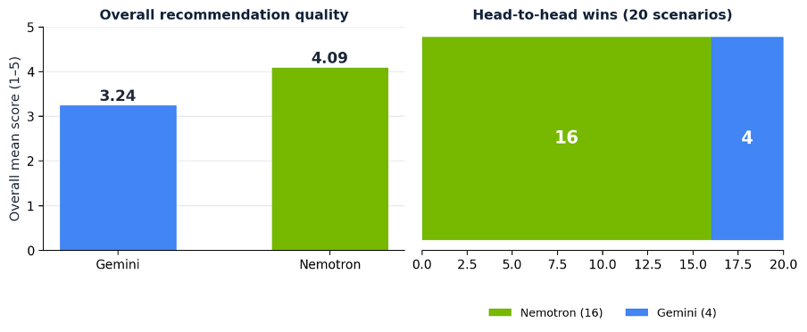
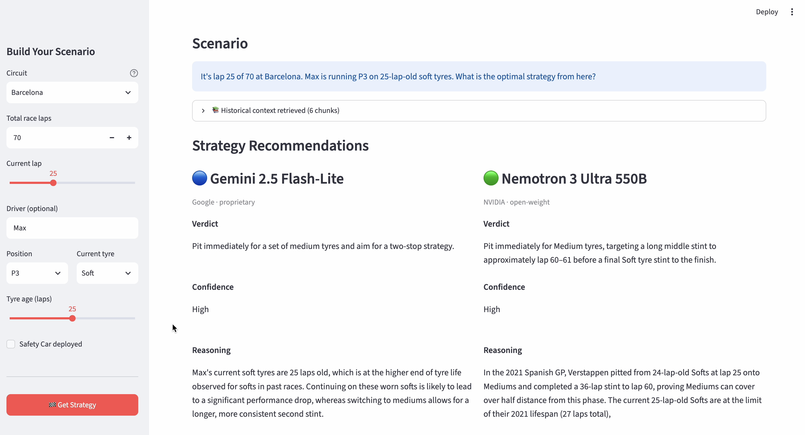
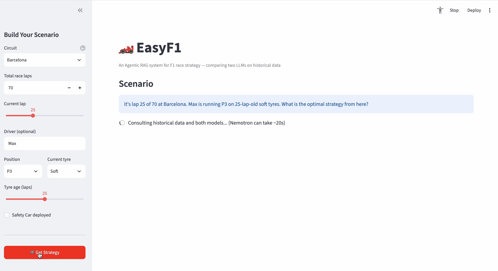

# EasyF1 — Agentic RAG for Formula 1 Race Strategy

[](https://www.python.org/)
[](https://github.com/langchain-ai/langgraph)
[](https://www.trychroma.com/)
[](https://streamlit.io/)
[](#)

> **A controlled empirical comparison of a proprietary vs an open-weight LLM on domain reasoning, grounded in a Retrieval-Augmented Generation system over 3 seasons of real Formula 1 data.**

---

## TL;DR

- Built an **Agentic RAG system** that recommends mid-race F1 strategy, grounded in **6,204 strategic chunks** retrieved from 53 real races (2021–2023).
- Designed a **bias-resistant LLM-as-judge evaluation** across 20 scenarios on 5 dimensions, plus RAGAS retrieval metrics.
- **Headline finding:** the open-weight model (Nemotron 3 Ultra 550B) outperformed the proprietary one (Gemini 2.5 Flash-Lite) — **4.09/5 vs 3.24/5**, winning **16 of 20** head-to-head comparisons.
- Zero paid-API infrastructure for the core pipeline; a **provider-agnostic design** survived a free-tier model deprecation mid-project without a rewrite.

---

## Headline Results



| Metric                               | Gemini 2.5 Flash-Lite | Nemotron 3 Ultra 550B |
| ------------------------------------ | --------------------- | --------------------- |
| Overall mean score (1–5)             | 3.24                  | **4.09**              |
| Head-to-head wins (of 20 scenarios)  | 4                     | **16**                |

Scoring: blind, position-randomised, by a **neutral third-party LLM-as-judge** on correctness, completeness, clarity, faithfulness, and reasoning quality.

---

## The Product



A user builds a hypothetical mid-race scenario — circuit, lap, tyre compound and age, track position, safety car. EasyF1 retrieves relevant historical precedent from its vector store and both LLMs return a structured recommendation (verdict, confidence, reasoning, risk) **side by side**, so the user can compare and decide.

**It advises; the human decides.**



> Additional screenshots: `docs/screenshots/` — retrieval detail, dark mode, full strategy breakdown.

---

## Why This Project Is Interesting

- **Controlled comparison, not a leaderboard.** Both models receive identical retrieved context via direct calls, isolating the model as the only variable — the deliberate opposite of a typical agentic benchmark where tool-use noise contaminates the signal.
- **Bias-resistant evaluation.** A neutral third-party judge model, blind and position-randomised, scores both answers. Pattern used widely in LLM evaluation research but rarely in student projects.
- **Two-tier chunking.** 6,204 high-signal chunks (strategic moments + outcome summaries) instead of ~55,000 noisy per-lap chunks — a deliberate retrieval-precision trade-off.
- **Zero-cost constraint, respected.** Local embeddings (fastembed), free-tier model access, open-weight model via OpenRouter. The provider-agnostic layer was validated when a free-tier model was deprecated mid-project.
- **Honest limitations.** 53 of 66 scheduled races ingested; the rest failed to load owing to intermittent gaps in the public F1 timing API — disclosed, not papered over.

---

## Architecture

```
┌─────────────┐    ┌───────────────────────────┐    ┌───────────┐    ┌──────────────┐
│  Scenario   │───▶│  Venue-weighted retrieval │───▶│  Prompt   │───▶│  Two LLMs    │
│  (sidebar)  │    │  (ChromaDB vector store)  │    │           │    │  (parallel)  │
└─────────────┘    └───────────────────────────┘    └───────────┘    └───────┬──────┘
                                 │                                           │
                                 ▼                                           ▼
                   ┌──────────────────────────┐              ┌────────────────────────────┐
                   │  FastF1 data             │              │  Side-by-side comparison   │
                   │  → two-tier chunking     │              │  (verdict, confidence,     │
                   │  → local embeddings      │              │   reasoning, risk)         │
                   └──────────────────────────┘              └────────────────────────────┘
```

**ReAct Agent** (LangGraph) coordinates three tools: semantic race-data retrieval, deterministic pit-loss calculation, and tyre-condition assessment — combining evidence-based retrieval with reliable computation.

---

## Tech Stack

| Layer         | Tools |
| ------------- | ----- |
| Data pipeline | FastF1, Python 3.11, Parquet |
| Retrieval     | ChromaDB, fastembed (BGE-Small, 384-dim) |
| Orchestration | LangGraph (ReAct agent, 3 tools) |
| Models        | Google Gemini 2.5 Flash-Lite (proprietary), NVIDIA Nemotron 3 Ultra 550B via OpenRouter (open-weight) |
| Evaluation    | LLM-as-judge (Nemotron Super 120B as neutral judge), RAGAS metrics |
| Interface     | Streamlit |

---

## Quickstart

```bash
git clone https://github.com/Mir-Brookes/easyf1-dissertation.git
cd easyf1-dissertation

python -m venv venv
source venv/bin/activate            # macOS / Linux
# venv\Scripts\activate              # Windows

pip install -r requirements.txt

cp .env.example .env                # add GEMINI_API_KEY and OPENROUTER_API_KEY

cd app
streamlit run easyf1_app.py
```

Full setup, repo structure, and dissertation methodology are in [`README.md`](README.md).

---

## What I'd Do Next

- **Retrieval completeness** was the highest-leverage weak spot — a hybrid retriever (dense + BM25 keyword) with reranking is the clearest next step.
- **Live data ingestion** instead of pre-built chunks, so the system covers races within hours of them finishing.
- **Evaluation at scale** — 20 scenarios is enough to show a signal; 200 would let the comparison be definitive, with cost-per-scenario and latency as additional axes.
- **Fine-tuning the judge** for F1-specific vocabulary, to reduce semantic drift on strategy-specific terms.

---

## About the Author

**Mir Mustafa Ali** — MSc Data Science & AI, Oxford Brookes University (2025–2026).
Transitioning from 3.5 years of Software QA on consumer and enterprise SaaS (PureVPN, Puredome) into Product Management and AI Analyst roles.

- **LinkedIn:** [linkedin.com/in/mir-mustafa-ali-a54289144](https://www.linkedin.com/in/mir-mustafa-ali-a54289144/)
- **Email:** mirmustafaaly@outlook.com
- **Demo video:** _available on request_

---

*Project supervised by Hong Zhu, Oxford Brookes University, as part of COMP7039 — MSc Dissertation in Computing Subjects.*
